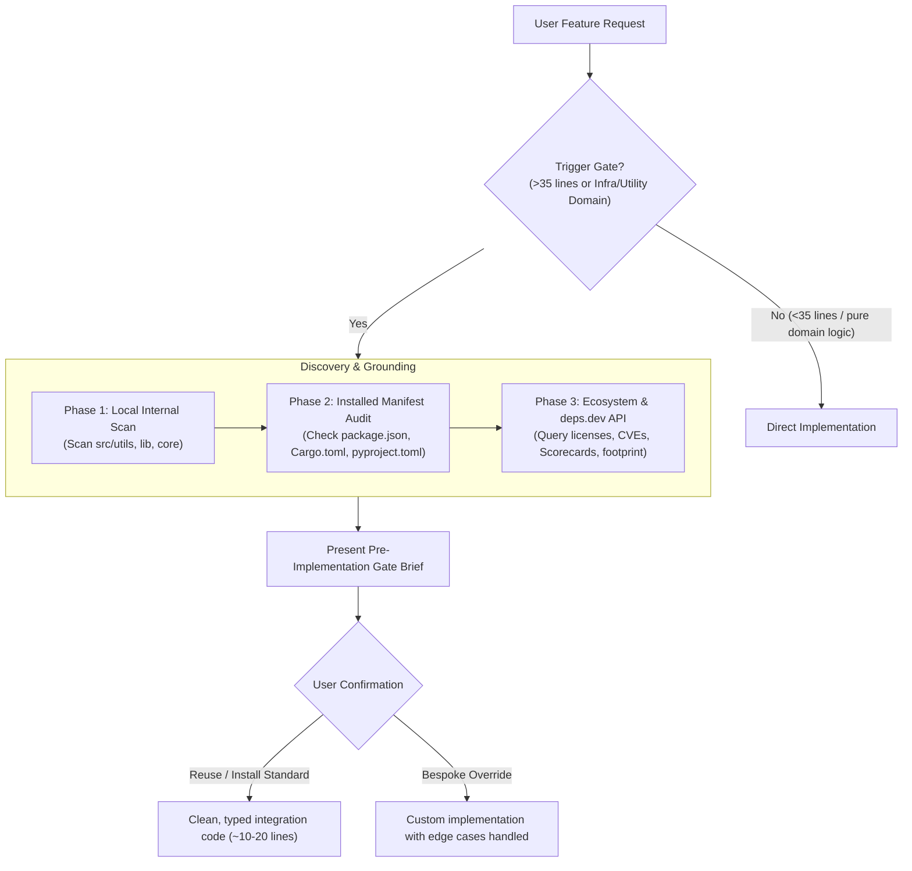

<div align="center">

# 🛡️ arch-scout

**Stop AI coding agents from reinventing the wheel.**

An open-source, hybrid **"Skill-First, MCP-Enhanced"** architecture scout that intercepts coding agents *before* implementation, audits local workspace utilities, and queries Google's `deps.dev` + live package registries to enforce grounded **Build vs. Reuse** decisions.

[](LICENSE)
[](https://modelcontextprotocol.io)
[](package.json)
[](mcp-server/test)

---

</div>

## 💥 The Problem: The Bespoke Code Trap

Modern AI coding agents (Claude Code, Cursor, Copilot Workspace, Antigravity) are biased toward generation. When asked for features like:
- Exponential backoff & jitter retries
- Rate limiting or token buckets
- Date/time duration formatting
- Schema validation & sanitization
- Concurrency pools & mutexes

...agents default to writing **50–300 lines of fragile, untested bespoke boilerplate from scratch**. 

This introduces:
1. **Silent Edge-Case Bugs:** Bespoke crypto, date math, or concurrency logic rarely covers leap seconds, Unicode normalization, or race conditions.
2. **Maintenance Bloat:** Your repository inherits hundreds of lines of non-core code requiring internal unit tests and long-term ownership.
3. **Ignored Codebase Assets:** Agents routinely duplicate utilities already sitting in `src/utils/` or reimplement functionality already available in installed dependencies (`lodash`, `zod`, `tenacity`, `p-retry`, `tokio`).

---

## 💡 The Solution: Skill-First, MCP-Enhanced

`arch-scout` introduces an architectural decision barrier between the user's prompt and code synthesis.



1. **Skill Layer:** Portable prompts compatible with Claude Code, Cursor, and Antigravity enforce the discovery sequence and pause code generation.
2. **MCP Layer:** A lightweight TypeScript server provides real-time workspace manifest parsing and live queries to Google's `deps.dev` API and language registries (npm, PyPI, Crates.io).

---

## 📦 Repository Structure

```text
arch-scout/
├── skills/
│   ├── SKILL.md                # Portable Agent Skill (Claude Code / Open Standard)
│   ├── .cursorrules            # Drop-in rules for Cursor AI
│   └── CLAUDE.md               # Drop-in instructions for Claude Code
├── mcp-server/                 # TypeScript Model Context Protocol (MCP) server
│   ├── src/
│   │   ├── index.ts            # Server entry point & tool registration
│   │   ├── manifest-scanner.ts # Multi-language manifest parser & internal util scanner
│   │   ├── registry-client.ts  # deps.dev v3 API + npm + PyPI + Crates.io client
│   │   └── types.ts            # Shared data contracts
│   ├── test/                   # Vitest unit & integration test suite
│   ├── package.json
│   └── tsconfig.json
├── LICENSE                     # Apache-2.0
└── README.md
```

---

## 🚀 Quickstart & Setup

### 1. Run MCP Server via NPX or Claude Desktop

Add `arch-scout` to your `claude_desktop_config.json` or MCP client settings:

```json
{
  "mcpServers": {
    "arch-scout": {
      "command": "node",
      "args": ["/path/to/arch-scout/mcp-server/dist/index.js"]
    }
  }
}
```

Or run directly from source:
```bash
git clone https://github.com/Walvinnie1/arch-scout.git
cd arch-scout/mcp-server
npm install
npm run build
npm start
```

### 2. Drop-in Agent Skills

Choose your development environment:

#### For Claude Code
Place [CLAUDE.md](skills/CLAUDE.md) in your project root or append its contents to your existing `CLAUDE.md`.

#### For Cursor
Place [.cursorrules](skills/.cursorrules) in your repository root.

#### For Antigravity / Gemini CLI
Copy [SKILL.md](skills/SKILL.md) to your workspace or global skills directory:
```bash
mkdir -p .agents/skills/arch-scout
cp skills/SKILL.md .agents/skills/arch-scout/SKILL.md
```

---

## 🛠️ MCP Tools Reference

The server exposes three specialized tools designed for AI coding agents:

### 1. `scan_workspace_architecture`
Recursively detects manifests and maps your workspace's installed dependencies and shared utility files.
- **Manifests Parsed:** `package.json`, `pyproject.toml`, `requirements.txt`, `Cargo.toml`, `pom.xml`, `go.mod`.
- **Shared Utils Tracked:** Inspects `utils/`, `lib/`, `common/`, `helpers/`, `core/`, `shared/`.
- **Parameters:**
  - `workspacePath` *(optional, string)*: Directory root. Defaults to cwd.
  - `maxDepth` *(optional, number)*: Directory recursion depth. Defaults to 5.

### 2. `lookup_package_ecosystem`
Queries Google's `deps.dev` v3 API and native registries (npm, PyPI, Crates.io) to audit a library.
- **Data Retrieved:**
  - Permissive vs. copyleft license.
  - Active security advisories / CVEs (via OSV / deps.dev).
  - OpenSSF Scorecard maintenance score (0–10).
  - Latest version, homepage, and repository URL.
- **Parameters:**
  - `packageName` *(string, required)*: e.g. `"p-retry"`, `"tenacity"`, `"tokio"`.
  - `system` *(optional, string)*: `"npm"`, `"pypi"`, `"cargo"`, `"maven"`, `"go"`.

### 3. `evaluate_build_vs_reuse`
Performs an end-to-end evaluation for a specific task and produces a ready-to-display Markdown Decision Brief.
- **Parameters:**
  - `task` *(string, required)*: Brief description of the requested feature.
  - `candidatePackages` *(array of strings)*: Leading candidate OSS packages.
  - `system` *(string)*: Target package ecosystem.
  - `workspacePath` *(string)*: Workspace root.

---

## 📊 The Pre-Implementation Gate in Action

When a user asks:
> *"Write a retry mechanism for our external payment gateway with exponential backoff and jitter."*

Instead of immediately generating 120 lines of bespoke retry loops, the agent halts and outputs:

```markdown
### 🛡️ Architectural Check: Build vs. Reuse

- **Task:** Exponential backoff retry handler with jitter for external HTTP calls
- **Internal / Installed Match:** None found in local workspace

| Option: Reuse / Install `p-retry@6.2.0` | Option: Bespoke Implementation |
| :--- | :--- |
| **Code Footprint:** ~12 lines (integration wrapper) | **Code Footprint:** ~95 lines (custom logic) |
| **Maintenance:** Upstream maintained by ecosystem | **Maintenance:** Internal ownership, team test burden |
| **Security & Audits:** Handled upstream (CVEs: None (0), Scorecard: 8.5/10) | **Security & Audits:** Team must handle edge cases & timer leaks |
| **Dependencies:** +1 package (npm) | **Dependencies:** 0 new packages |
| **License:** MIT | **License:** Workspace native |

**Recommendation:** Option 1: Reuse / Install — Battle-tested community package with zero maintenance overhead.

👉 *Proceed with recommended approach, or prefer an alternative?*
```

---

## 🧪 Testing & Validation

The test suite validates manifest parsing across multiple languages (npm, Python Poetry/PEP 621, Rust Cargo, Maven, Go Modules) and registry integration:

```bash
cd mcp-server
npm test
```

All 10 tests run in <1s using Vitest.

---

## 📄 License

Licensed under the [Apache License, Version 2.0](LICENSE).
