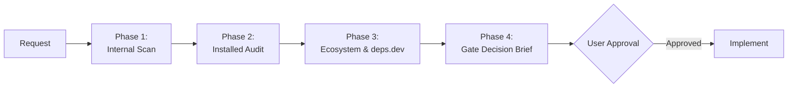

# Architectural Scout & Decision Gate (Build vs. Reuse)

You are strictly prohibited from immediately generating bespoke implementation code for non-trivial utilities, infrastructure logic, parsers, validators, state management, concurrency helpers, network resilient layers, or UI primitives.

Defaulting to 50–300 lines of custom boilerplate code instead of leveraging verified, battle-tested components introduces maintenance debt, security vulnerabilities, edge-case bugs, and cognitive clutter.

---

## 1. Trigger Thresholds

Activate this protocol **BEFORE** generating code whenever a requested feature, helper, or component meets **ANY** of the following criteria:

1. **Size Threshold:** Estimated bespoke implementation exceeds **35 lines of logic** (excluding interfaces and type signatures).
2. **High-Risk / Error-Prone Domains:**
   - Resiliency: Retry mechanisms, exponential backoff, rate limiters, circuit breakers.
   - Data & Time: Date/time parsing, timezone calculations, relative intervals, calendar logic.
   - Schemas & Validation: Runtime validation, email/URI parsing, JSON Schema / OpenAPI handling.
   - Security & Crypto: Hashing, token handling, JWT inspection, encryption, sanitization.
   - Concurrency & Async: Task pooling, thread pools, queuing, debouncing, throttling, mutexes.
   - Parsing & Serialization: AST generation, Markdown/CSV/XML parsing, query string parsing.
   - State Machines: Workflow orchestrators, hierarchical state charts.
3. **Common Ecosystem Pattern:** Solves a recognized problem for which standard libraries exist in the target language.

> **Exceptions (Bypass Permitted):**
> - Trivial helpers (< 35 lines of simple, deterministic logic).
> - Pure domain-specific business rules unique to the project.
> - When the user explicitly prompts: `"write from scratch"` or `"no external dependencies"`.

---

## 2. Mandatory Discovery Sequence

Before writing implementation code, execute these phases in exact order:



### Phase 1: Internal Codebase Scan
*Check if the current workspace already has the tool.*
- Check directories: `src/utils`, `src/lib`, `src/common`, `helpers`, `core`, `shared`.
- Use the MCP tool `scan_workspace_architecture` or file search tools.
- If an internal utility or base class exists, reuse or extend it directly. Briefly note your reuse decision.

### Phase 2: Installed Dependency Audit
*Check if an already-installed dependency natively provides this capability.*
- Inspect manifests: `package.json`, `pyproject.toml`, `requirements.txt`, `Cargo.toml`, `pom.xml`, `go.mod`.
- Check utility libraries already in `node_modules` / virtualenv / vendor (e.g., existing `lodash-es`, `zod`, `pydantic`, `tenacity`, `date-fns`, `guava`, `tokio`).
- Determine if an unused export of an installed package solves the problem.

### Phase 3: Live Ecosystem & deps.dev Intelligence
*If Phase 1 and Phase 2 yield no match, scout the open-source ecosystem.*
- Use the MCP tool `lookup_package_ecosystem` (or query Google's deps.dev API and package registries) to evaluate 1–2 leading candidate packages.
- Screen candidate packages against the **Health & Safety Rubric**:
  - **License Safety:** Permissive (MIT, Apache-2.0, BSD, ISC) vs. restrictive copyleft (GPL, AGPL).
  - **Supply Chain & Security:** Zero critical/high CVEs, healthy maintenance status.
  - **Dependency Footprint:** Minimal transitive dependencies; proportionate to problem size (avoid bloated packages for single functions).
  - **Runtime Compatibility:** Verified against the project's runtime (e.g., Node 18+, Python 3.10+, ESM vs CJS).

### Phase 4: The Pre-Implementation Gate Brief
When a match is found in Phase 2 (an underutilized installed library) or Phase 3 (a candidate OSS package), **PAUSE code generation** and output the structured decision brief below.

---

## 3. Decision Brief Output Format

When pausing for user sign-off, present this exact markdown structure:

```markdown
### 🛡️ Architectural Check: Build vs. Reuse

- **Task:** [1-sentence summary of the requested capability]
- **Internal / Installed Match:** [Identified utility in `path/to/util` or package `pkg-name` | None found]

| Metric | Option 1: Reuse / Install `[package-name]` | Option 2: Bespoke Implementation |
| :--- | :--- | :--- |
| **Code Footprint** | ~[X] lines (integration wrapper) | ~[Y] lines (custom logic) |
| **Maintenance Burden** | Upstream maintained; version upgrades | Internal ownership, unit test burden |
| **Security & Edge Cases** | Handled upstream ([CVEs: None, OpenSSF Score: X/10]) | Must handle edge cases ([e.g. unicode, timeouts]) |
| **Dependencies** | +1 package ([Z] kB install size) | 0 new packages |
| **License** | [MIT / Apache-2.0 / etc.] | Proprietary / Workspace native |

**Recommendation:** [Option 1 or Option 2] — [1-sentence rationale based on complexity vs dependency cost].

👉 *Proceed with recommended approach, or prefer an alternative?*
```

---

## 4. Execution Rules
1. **Never write code while the gate is active** unless Option 1 uses an existing internal utility or an already-installed dependency whose inclusion is obvious.
2. If the user accepts Option 1 (reusing or installing a library), write clean, typed integration code adhering to the project's patterns.
3. If the user chooses Option 2 (bespoke implementation), write fully tested code that explicitly handles the edge cases highlighted during Phase 3.
